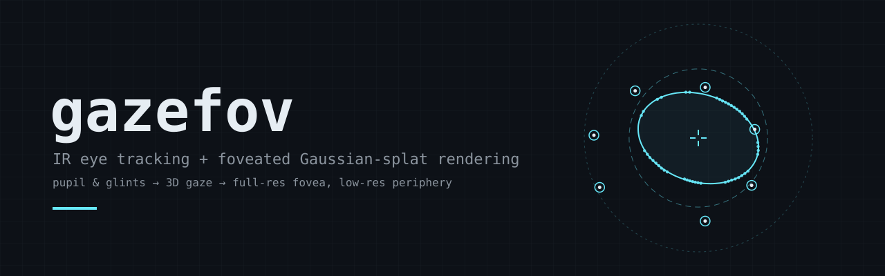
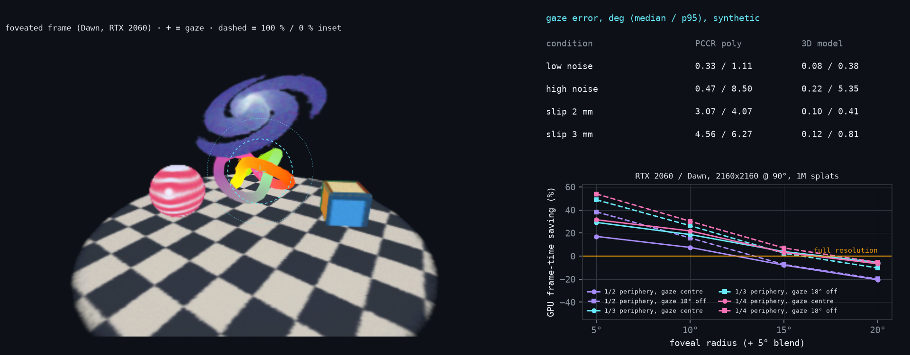
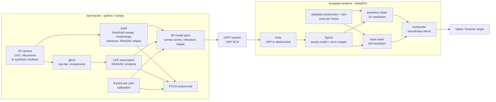
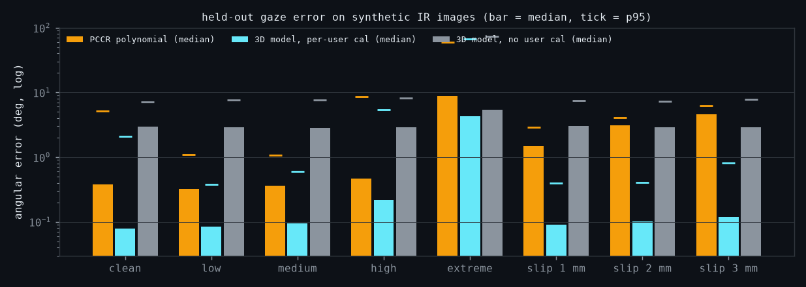
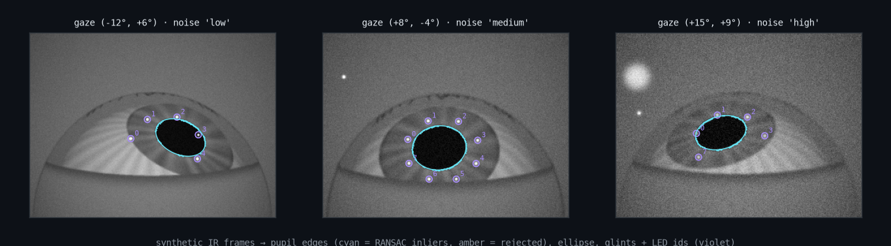
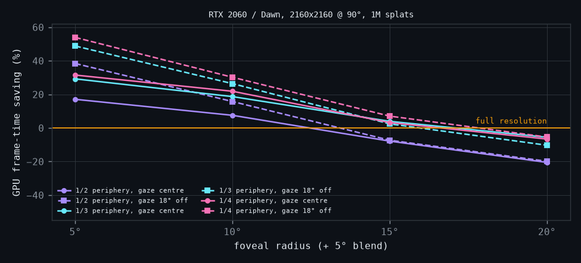

<p align="center"></p>

<p align="center">
  <a href="https://github.com/coopersimpson101-debug/gazefov/actions/workflows/ci.yml"></a>
  <a href="https://github.com/coopersimpson101-debug/gazefov/releases"></a>
  <a href="LICENSE"></a>
  
  
  
</p>

**gazefov** is an eye-tracking and foveated-rendering stack for a VR headset: a ray-traced synthetic
IR eye camera with exact ground truth, a hand-written pupil + corneal-glint pipeline with per-user
calibration and two gaze estimators, and a WebGPU Gaussian-splat renderer that spends full
resolution only where the eye is looking.

[](https://coopersimpson101-debug.github.io/gazefov/)

[Live demo](https://coopersimpson101-debug.github.io/gazefov/) · [How it works](#how-it-works) · [Results](#results) · [Eye-tracking maths](docs/eye-tracking.md) ·
[Foveation](docs/foveation.md) · [Hardware & eye safety](docs/hardware.md) ·
[Gaze protocol](docs/protocol.md) · [Vanta adapter](docs/vanta-adapter.md)

<p align="center"></p>

*Left: a real frame from the foveated renderer (Dawn/WebGPU, RTX 2060, 1 M splats, 1280×800; `+` is
the gaze point, inner dashed circle = 100 % full-resolution inset, outer = 100 % 1/3-resolution
periphery). Right: held-out gaze error on synthetic IR images, and GPU frame time vs foveal radius
at 2160×2160 per eye. All three are produced by scripts in this repo (`npm run hero`,
`scripts/eval_gaze.py`, `npm run bench`, `scripts/make_figures.py`).*

## Highlights

- **Synthetic IR eye camera with exact ground truth** — per-pixel ray tracing of eyelids, eyelashes,
  a *refracting* spherical cornea (Snell, n = 1.3375), pupil/iris and sclera; glints of an 8-LED
  850 nm ring from the spherical-mirror reflection law; blur, shot/read noise, occluders, spurious
  reflections and headset slippage.
- **Pupil + glint pipeline, hand-written in numpy**: glint in-painting, MSER-like threshold sweep,
  morphology, vectorised connected components, Starburst edges, RANSAC direct-least-squares ellipse;
  top-hat glint detection and RANSAC similarity association of glints to LEDs.
- **Two gaze estimators with 9-point per-user calibration**: PCCR + 2nd-order polynomial, and a 3D
  model (cornea centre from glints, refraction-aware pupil centre, kappa; calibrates kappa, R, K).
- **Measured on 2 560 held-out synthetic frames** (8 subjects): 3D model **0.08° median / 0.38° p95**
  at low noise, and still **0.12° median at 3 mm headset slippage** where the polynomial degrades to
  4.56°.
- **Foveated splat rendering on WebGPU**: preprocess and depth sort shared between a low-resolution
  periphery and a full-resolution inset (splatweb's core, vendored), re-filtered down-sampling,
  smooth radial blend; the fovea is sized from an acuity model plus the measured tracker error.
- **Honest GPU numbers**: GPU timestamp queries on an RTX 2060 via Dawn, foveated and full-resolution
  frames interleaved, with PSNR/SSIM per eccentricity region — 15–21 % lower GPU frame time with an acuity-sized fovea at centre gaze (2160² per eye, 1 M splats), up to 54 % with a 5° fovea; larger foveae are slower, and the README says why.
- **Plumbing for a headset**: 92-byte GZFV UDP gaze packet (Python ↔ TypeScript golden vector), a
  UDP→WebSocket relay, a 1€ gaze filter with saccade flag, a Vanta adapter interface, IEC 62471
  LED-exposure budget and camera hooks (UVC, libcamera).

## Status

| part | status | evidence |
|---|---|---|
| synthetic IR renderer, pupil/glint pipeline, both gaze methods, calibration | ✅ | 29 pytest tests pass, 1 hardware test skipped (`pytest`) |
| gaze accuracy in degrees (noise × slippage) | 🧪 | synthetic only — `results/gaze_accuracy.md` |
| real IR eye dataset evaluation | ⏳ | none downloaded; see [docs/datasets.md](docs/datasets.md) |
| foveated renderer, composite, layout, acuity model | ✅ | 14 unit tests + 3 GPU tests on Dawn (RTX 2060) |
| frame-time saving + image quality | ✅ measured here | `results/foveation_bench.json` (procedural splat scene) |
| browser demo (`render/index.html`, pointer as gaze) | ✅ | [live on GitHub Pages](https://coopersimpson101-debug.github.io/gazefov/); opened in a Chromium WebGPU browser on the RTX 2060 (2026-11-26): inset follows the pointer, F and B keys work, no console errors. Needs a WebGPU browser |
| gaze protocol, relay, filter | ✅ | golden vector in both languages, UDP loopback, RFC 6455 vectors |
| Vanta adapter | ⏳ | interface + host-agnostic driver; Vanta mapping needs Vanta's API |
| IR camera + LED ring, eye safety, latency | ⏳ | design notes + calculations only — [docs/hardware.md](docs/hardware.md) |
| real-time tracker | ⏳ | numpy reference: 158 ms/frame median here (not real-time) |

## Quickstart

```bash
pip install -e ".[test,plot]" && pytest                      # tracker + protocol tests
python scripts/eval_gaze.py --subjects 2 --test 10 --quick    # small accuracy run (~2 min)
cd render && npm ci && npm test                               # renderer tests (GPU tests need a WebGPU adapter)
npm run bench -- --frames 60                                  # foveation benchmark on your GPU (Dawn, headless)
npm run build && npx vite preview                             # browser demo: the pointer is the gaze (F / B keys)
```

## How it works



**Eye model.** The cornea is a sphere (radius R) whose centre c sits D = 5.3 mm in front of the
eye's rotation centre; the pupil is a disc K = 4.2 mm further along the optical axis w; the visual
axis through c is offset from w by kappa (α ≈ 5°, β ≈ 1.5°), which differs per person — the reason a
user calibration exists at all (Guestrin & Eizenman 2006).

**Glints.** An LED at l reflects off the cornea at the point q where the surface normal bisects the
directions to the camera o and to l: `(q − c)/R = normalize(û(q→o) + û(q→l))`. The renderer solves
this by fixed-point iteration; the tracker inverts it.

**Cornea centre from glints.** Reflection is coplanar, so c lies in the plane through o spanned by
`l_i − o` and the glint ray `r_i`. Two or more glints put c on a line `o + k b` (b = null vector of
the plane normals); a 1-D scan and a Levenberg–Marquardt refinement of the reflection residual give
c — exactly (< 1 µm) from exact glints.

**Pupil centre with refraction.** The ray through the pupil-ellipse centre is refracted at the
cornea and p is placed at |p − c| = K. Because the centre of the pupil's *image* is not the image of
its centre, the RANSAC edge points are refracted onto the pupil plane and a circle fit there updates
p and w (3 iterations). Gaze = visual axis from c intersected with the display plane.

**PCCR.** The pupil centre expressed in the glint pattern's similarity frame (robust to glint
dropout, normalised for distance) mapped by a 6-term quadratic polynomial fitted to 9 targets. It
works well when the headset does not move — and cannot know when it has. The 3D model measures c
every frame, so slippage changes the measured eye position rather than the answer.

**Foveation.** Minimum angle of resolution grows linearly with eccentricity, MAR(e) = 0.022 e + 1/48
deg (Guenter et al. 2012, conservative slope). A periphery at scale s on an 18.8 px/deg display is
acuity-matched beyond (1/(s·ppd) − 1/48)/0.022: 3.9° for s = 1/2, 6.3° for 1/3, 8.7° for 1/4. The
inner radius adds the tracker's measured p95 error (rounded to 1°) and a 2° latency margin. Both
layers reuse one preprocess and one sort (their projections differ only by an affine map in pixel
space); down-scaled splats get the EWA low-pass re-applied with energy-preserving opacity.

Full derivations: [docs/eye-tracking.md](docs/eye-tracking.md), [docs/foveation.md](docs/foveation.md).

```text
gazefov/            python tracker: geometry, eye_model, render_ir, imgproc, ellipse, pupil, glints,
                    gaze_poly, gaze_model, optim, tracker, protocol, camera, safety
scripts/            eval_gaze.py, make_figures.py, make_banner.py, results_tables.py, make_protocol_fixture.py
tests/              pytest suite + shared golden packet (tests/fixtures)
render/src/         foveation/ (renderer, layout, acuity, metrics, WGSL), gaze/ (protocol, filter, sources),
                    vanta/ (adapter), demo/, vendor/splatweb/ (v0.1.0, MIT, unmodified)
render/scripts/     bench.ts (Dawn benchmark + hero), relay.ts (UDP -> WebSocket), png.ts
results/            gaze_accuracy.{json,md}, foveation_bench.json
```

## Results

### Gaze accuracy 🧪 (synthetic IR images)

`python scripts/eval_gaze.py` — 8 synthetic subjects (random R, K, D, kappa, iris, lids, lashes),
9-point calibration on a ±15° × ±11° grid at zero slip, 40 held-out targets per subject and
condition drawn uniformly in ±20° × ±15° (so some extrapolate beyond the calibration grid), random
pupil radius 1.4–3.0 mm per frame, 320 × 240 camera, 2×2 super-sampling. Angular error at the true
cornea centre, **mean / median / p95 in degrees**; failed frames (no pupil or < 2 associated
glints) are counted in "valid" and excluded from the statistics. Ryzen 5 3600, Python 3.12, numpy
2.5, 2026-11-26.

| condition | valid frames | PCCR + polynomial | 3D model, kappa+R+K cal | 3D model, kappa-only cal | 3D model, no user cal |
|---|---:|---:|---:|---:|---:|
| clean noise, no slip | 319/320 | 1.32 / 0.38 / 5.13 | **0.39 / 0.08 / 2.09** | 1.26 / 1.03 / 2.96 | 3.45 / 2.99 / 7.04 |
| low noise, no slip | 320/320 | 0.55 / 0.33 / 1.11 | **0.25 / 0.08 / 0.38** | 1.28 / 0.95 / 3.13 | 3.41 / 2.89 / 7.57 |
| medium noise, no slip | 320/320 | 0.56 / 0.36 / 1.07 | **0.37 / 0.09 / 0.60** | 1.34 / 0.95 / 3.45 | 3.40 / 2.84 / 7.58 |
| high noise, no slip | 318/320 | 2.20 / 0.47 / 8.50 | **1.39 / 0.22 / 5.35** | 2.08 / 1.08 / 4.68 | 4.11 / 2.90 / 8.14 |
| extreme noise, no slip | 241/320 | 15.82 / 8.73 / 59.22 | **13.07 / 4.27 / 67.48** | 13.25 / 2.56 / 65.44 | 14.59 / 5.36 / 73.61 |
| low noise, slip 1 mm | 320/320 | 1.71 / 1.48 / 2.86 | **0.36 / 0.09 / 0.40** | 1.35 / 1.00 / 3.17 | 3.44 / 3.03 / 7.44 |
| low noise, slip 2 mm | 320/320 | 2.89 / 3.07 / 4.07 | **0.20 / 0.10 / 0.41** | 1.21 / 0.98 / 2.95 | 3.36 / 2.87 / 7.24 |
| low noise, slip 3 mm | 320/320 | 4.44 / 4.56 / 6.27 | **0.54 / 0.12 / 0.81** | 1.56 / 1.07 / 3.53 | 3.54 / 2.87 / 7.72 |

Detector accuracy against the renderer's ground truth (pupil reference = centroid of the visible
pupil label, which is biased when a lid covers part of the pupil, inflating the p95):

| condition | pupil centre error px (median / p95) | glint error px (median / p95) | cornea centre error mm (median) |
|---|---:|---:|---:|
| clean/slip0mm | 0.39 / 3.66 | 0.08 / 0.18 | 0.44 |
| low/slip0mm | 0.38 / 4.71 | 0.07 / 0.18 | 0.47 |
| medium/slip0mm | 0.40 / 5.50 | 0.09 / 0.24 | 0.47 |
| high/slip0mm | 0.45 / 6.87 | 0.17 / 0.45 | 0.46 |
| extreme/slip0mm | 3.63 / 29.02 | 0.46 / 33.34 | 0.51 |
| low/slip1mm | 0.38 / 5.80 | 0.07 / 0.19 | 0.45 |
| low/slip2mm | 0.40 / 4.37 | 0.07 / 0.19 | 0.45 |
| low/slip3mm | 0.42 / 6.90 | 0.07 / 0.19 | 0.46 |

Readings: per-user calibration of kappa *and* corneal shape is what gets the 3D model below 0.1°;
with population constants it is ~3° off (this is why every commercial tracker calibrates). PCCR is
competitive when nothing moves but loses ~1.4° per mm of headset slippage. Everything degrades
sharply at the "extreme" noise level (σ = 16 DN, heavy blur, two occluders): 25 % of frames fail
and p95 errors exceed 50°. The numbers are an upper bound on what the algorithms can do: the
synthetic eye obeys the same spherical-cornea model the estimator assumes.

<p align="center"></p>
<p align="center"></p>

### Foveated rendering frame time ✅ (measured here)

`cd render && npm run bench -- --frames 100 --gazes "0,0;0.3,0.15"` — NVIDIA RTX 2060 (Dawn D3D12,
`webgpu` npm package), 2160 × 2160 per eye, 90° vertical FOV (18.8 px/deg), splatweb's procedural
scene with 1 000 000 splats (SH degree 3), orbiting camera. GPU timestamp queries around the whole
frame; each foveated configuration is interleaved frame by frame with the full-resolution renderer
(same camera, same frames) and the saving is the median of the per-frame ratios. **The GPU was
shared with other jobs (nvidia-smi showed 97–100 % utilisation before the run), so absolute
milliseconds are inflated and noisy; the interleaved ratios are the robust number.** Quality: PSNR /
SSIM of luma against the full-resolution frame, split into fovea (r < r_in), blend band and
periphery. Blend band 5°.

Like-for-like baselines on the same run: splatweb's own `SplatRenderer` 23.72 ms, this renderer's single full-resolution layer 21.76 ms (preprocess 0.92 + sort 4.13 + raster 16.71 ms) — rasterisation is 77 % of the frame, which is what foveation can cut. In a quieter earlier run (same scene, not interleaved) the full-resolution frame took 15.27 ms and the centred-gaze savings matched these to within 3 points on 14 of 15 rows (the exception is a low-confidence row below). "Frames kept": frames whose full-resolution time was > 25 % above that configuration's minimum (another GPU client was active) are dropped in pairs; three rows kept < 10 frames and are less certain.

**Key rows** (5° fovea, and the acuity-derived fovea for each periphery scale):

| gaze | periphery | inner radius | shaded px | foveated ms | full-res ms (same frames) | saving (frames kept) | periphery / inset / composite ms | PSNR fovea / blend / periphery (dB) | SSIM periphery |
|---|---:|---:|---:|---:|---:|---:|---:|---:|---:|
| centre | 1/2 | 5° | 28 % | 18.22 | 22.02 | **17 %** (107/120) | 6.88 / 6.09 / 0.07 | 70.3 / 38.2 / 43.0 | 0.992 |
| centre | 1/3 | 5° | 14 % | 15.93 | 22.48 | **29 %** (120/120) | 4.78 / 5.90 / 0.07 | 70.3 / 32.2 / 38.0 | 0.988 |
| centre | 1/4 | 5° | 9 % | 15.40 | 22.68 | **31 %** (120/120) | 3.93 / 6.16 / 0.07 | 70.3 / 28.7 / 35.0 | 0.984 |
| centre | 1/2 | 6.9° (acuity) | 30 % | 19.46 | 22.74 | **15 %** (120/120) | 7.08 / 6.88 / 0.07 | 70.7 / 36.8 / 43.5 | 0.992 |
| centre | 1/3 | 9.3° (acuity) | 18 % | 17.89 | 22.81 | **21 %** (120/120) | 4.85 / 7.93 / 0.07 | 70.9 / 32.9 / 39.1 | 0.989 |
| centre | 1/4 | 11.7° (acuity) | 15 % | 18.42 | 22.94 | **18 %** (120/120) | 3.67 / 9.57 / 0.07 | 70.8 / 31.1 / 36.7 | 0.987 |
| (0.3, 0.15) NDC | 1/2 | 5° | 29 % | 13.76 | 22.74 | **38 %** (120/120) | 6.95 / 1.51 / 0.07 | ∞ / 39.5 / 42.6 | 0.991 |
| (0.3, 0.15) NDC | 1/3 | 5° | 16 % | 11.60 | 22.94 | **49 %** (120/120) | 4.78 / 1.51 / 0.07 | ∞ / 33.8 / 37.4 | 0.987 |
| (0.3, 0.15) NDC | 1/4 | 5° | 11 % | 10.42 | 22.81 | **54 %** (120/120) | 3.67 / 1.51 / 0.07 | ∞ / 30.9 / 34.3 | 0.983 |
| (0.3, 0.15) NDC | 1/2 | 6.9° (acuity) | 31 % | 15.40 | 22.94 | **32 %** (119/120) | 6.95 / 3.08 / 0.07 | ∞ / 39.6 / 42.8 | 0.991 |
| (0.3, 0.15) NDC | 1/3 | 9.3° (acuity) | 21 % | 16.71 | 21.10 | **20 %** (6/120) | 4.85 / 6.62 / 0.07 | 81.7 / 36.3 / 38.0 | 0.988 |
| (0.3, 0.15) NDC | 1/4 | 11.7° (acuity) | 20 % | 18.15 | 22.87 | **20 %** (119/120) | 4.06 / 8.72 / 0.07 | 77.1 / 33.7 / 35.2 | 0.985 |

<details><summary>All 30 configurations</summary>

| gaze | periphery | inner radius | shaded px | foveated ms | full-res ms (same frames) | saving (frames kept) | periphery / inset / composite ms | PSNR fovea / blend / periphery (dB) | SSIM periphery |
|---|---:|---:|---:|---:|---:|---:|---:|---:|---:|
| centre | 1/2 | 5° | 28 % | 18.22 | 22.02 | **17 %** (107/120) | 6.88 / 6.09 / 0.07 | 70.3 / 38.2 / 43.0 | 0.992 |
| centre | 1/2 | 10° | 32 % | 20.58 | 22.09 | **8 %** (119/120) | 6.88 / 8.26 / 0.07 | 71.0 / 38.5 / 44.2 | 0.992 |
| centre | 1/2 | 15° | 38 % | 23.92 | 21.95 | **-8 %** (119/120) | 6.88 / 11.53 / 0.07 | 71.4 / 39.9 / 46.1 | 0.993 |
| centre | 1/2 | 20° | 47 % | 26.87 | 22.41 | **-21 %** (115/120) | 7.01 / 14.61 / 0.07 | 71.6 / 45.9 / 48.1 | 0.993 |
| centre | 1/3 | 5° | 14 % | 15.93 | 22.48 | **29 %** (120/120) | 4.78 / 5.90 / 0.07 | 70.3 / 32.2 / 38.0 | 0.988 |
| centre | 1/3 | 10° | 18 % | 18.22 | 22.48 | **19 %** (117/120) | 4.85 / 8.13 / 0.07 | 71.0 / 33.1 / 39.4 | 0.989 |
| centre | 1/3 | 15° | 25 % | 21.63 | 22.74 | **4 %** (120/120) | 4.78 / 11.60 / 0.07 | 71.4 / 34.9 / 41.3 | 0.991 |
| centre | 1/3 | 20° | 33 % | 16.12 | 15.27 | **-6 %** (5/120) | 3.15 / 9.37 / 0.07 | 71.6 / 40.1 / 43.6 | 0.992 |
| centre | 1/4 | 5° | 9 % | 15.40 | 22.68 | **31 %** (120/120) | 3.93 / 6.16 / 0.07 | 70.3 / 28.7 / 35.0 | 0.984 |
| centre | 1/4 | 10° | 14 % | 17.83 | 22.74 | **22 %** (119/120) | 3.93 / 8.26 / 0.07 | 71.0 / 30.0 / 36.3 | 0.986 |
| centre | 1/4 | 15° | 20 % | 15.93 | 16.97 | **3 %** (7/120) | 3.15 / 8.85 / 0.07 | 71.4 / 32.0 / 38.0 | 0.988 |
| centre | 1/4 | 20° | 28 % | 24.38 | 22.81 | **-7 %** (120/120) | 4.00 / 14.75 / 0.07 | 71.6 / 36.5 / 40.1 | 0.990 |
| centre | 1/2 | 6.9° (acuity) | 30 % | 19.46 | 22.74 | **15 %** (120/120) | 7.08 / 6.88 / 0.07 | 70.7 / 36.8 / 43.5 | 0.992 |
| centre | 1/3 | 9.3° (acuity) | 18 % | 17.89 | 22.81 | **21 %** (120/120) | 4.85 / 7.93 / 0.07 | 70.9 / 32.9 / 39.1 | 0.989 |
| centre | 1/4 | 11.7° (acuity) | 15 % | 18.42 | 22.94 | **18 %** (120/120) | 3.67 / 9.57 / 0.07 | 70.8 / 31.1 / 36.7 | 0.987 |
| (0.3, 0.15) NDC | 1/2 | 5° | 29 % | 13.76 | 22.74 | **38 %** (120/120) | 6.95 / 1.51 / 0.07 | ∞ / 39.5 / 42.6 | 0.991 |
| (0.3, 0.15) NDC | 1/2 | 10° | 36 % | 19.14 | 23.07 | **16 %** (120/120) | 7.01 / 6.68 / 0.07 | 80.4 / 42.7 / 43.0 | 0.992 |
| (0.3, 0.15) NDC | 1/2 | 15° | 47 % | 24.44 | 23.07 | **-7 %** (120/120) | 7.01 / 11.99 / 0.07 | 75.4 / 44.5 / 43.4 | 0.992 |
| (0.3, 0.15) NDC | 1/2 | 20° | 63 % | 27.66 | 22.87 | **-20 %** (120/120) | 6.95 / 15.20 / 0.07 | 74.9 / 42.8 / 45.0 | 0.992 |
| (0.3, 0.15) NDC | 1/3 | 5° | 16 % | 11.60 | 22.94 | **49 %** (120/120) | 4.78 / 1.51 / 0.07 | ∞ / 33.8 / 37.4 | 0.987 |
| (0.3, 0.15) NDC | 1/3 | 10° | 22 % | 16.65 | 22.81 | **26 %** (120/120) | 4.85 / 6.55 / 0.07 | 80.4 / 36.6 / 38.1 | 0.988 |
| (0.3, 0.15) NDC | 1/3 | 15° | 33 % | 21.95 | 22.81 | **2 %** (120/120) | 4.85 / 11.86 / 0.07 | 75.4 / 38.4 / 38.7 | 0.989 |
| (0.3, 0.15) NDC | 1/3 | 20° | 49 % | 25.30 | 22.94 | **-10 %** (120/120) | 4.92 / 15.01 / 0.07 | 74.9 / 38.4 / 40.3 | 0.990 |
| (0.3, 0.15) NDC | 1/4 | 5° | 11 % | 10.42 | 22.81 | **54 %** (120/120) | 3.67 / 1.51 / 0.07 | ∞ / 30.9 / 34.3 | 0.983 |
| (0.3, 0.15) NDC | 1/4 | 10° | 17 % | 15.47 | 22.74 | **30 %** (120/120) | 3.67 / 6.55 / 0.07 | 80.4 / 33.1 / 35.0 | 0.984 |
| (0.3, 0.15) NDC | 1/4 | 15° | 28 % | 21.10 | 22.61 | **7 %** (120/120) | 3.67 / 12.19 / 0.07 | 75.4 / 34.8 / 35.7 | 0.986 |
| (0.3, 0.15) NDC | 1/4 | 20° | 44 % | 24.44 | 23.07 | **-5 %** (120/120) | 3.67 / 15.40 / 0.07 | 74.9 / 36.0 / 37.3 | 0.988 |
| (0.3, 0.15) NDC | 1/2 | 6.9° (acuity) | 31 % | 15.40 | 22.94 | **32 %** (119/120) | 6.95 / 3.08 / 0.07 | ∞ / 39.6 / 42.8 | 0.991 |
| (0.3, 0.15) NDC | 1/3 | 9.3° (acuity) | 21 % | 16.71 | 21.10 | **20 %** (6/120) | 4.85 / 6.62 / 0.07 | 81.7 / 36.3 / 38.0 | 0.988 |
| (0.3, 0.15) NDC | 1/4 | 11.7° (acuity) | 20 % | 18.15 | 22.87 | **20 %** (119/120) | 4.06 / 8.72 / 0.07 | 77.1 / 33.7 / 35.2 | 0.985 |

</details>

<p align="center"></p>

Readings. (1) Foveation pays only while the fovea is small: with the acuity-derived fovea (6.9–11.7° + 5° blend) the GPU frame time drops **15–21 %** at a centred gaze and **20–32 %** at 18° eccentricity, and with a 5° fovea up to 31 % / 54 %; from a 15° fovea on it is a wash and at 20° it is slower than full resolution. (2) The saving is far below the shaded-pixel fraction (e.g. 14 % of the pixels shaded but only 29 % faster): each layer re-runs the vertex stage for every visible splat, and the inset sits on the scene's densest overdraw (the inset costs 5.9 ms for ~3 % of the pixels at centre gaze, 1.5 ms when the gaze rests on sparse content off-centre). (3) Quality: the fovea is bit-identical or ≥ 70 dB PSNR to full resolution (the shared preprocess makes the inset an exact crop); the periphery is 34–45 dB PSNR / SSIM 0.983–0.993 against the full-resolution frame, below what the acuity model says is visible beyond the blend radius — but no user study was run. The obvious next step is per-layer instance compaction so the inset stops paying for splats it never touches.

## Hardware validation / TODO for the author

Nothing in this repository has run on a headset. To validate (details and empty tables in
[docs/hardware.md](docs/hardware.md), [docs/datasets.md](docs/datasets.md), [docs/vanta-adapter.md](docs/vanta-adapter.md)):

1. **Build one eye-cup** with the geometry in `gazefov/eye_model.py` (camera at (0, −17, 26) mm, 8 LEDs
   on a 19 mm ring); calibrate the camera intrinsics and LED positions.
2. **Eye safety first**: `python -m gazefov.safety` with your LED datasheet values, then measure the
   irradiance at the eye position with a radiometer (limit 100 W/m² for > 1000 s, IEC 62471 exempt).
3. **Capture**: `GAZEFOV_UVC_DEVICE=0 pytest tests/test_camera.py` then record 9 calibration + 20
   validation targets and fill:

| subject | method | mean (deg) | median (deg) | p95 (deg) | valid frames |
|---|---|---:|---:|---:|---:|
| | PCCR polynomial | | | | |
| | 3D model | | | | |

4. **Latency**: photodiode on the display + LED-flash test; target ≤ 50 ms eye-to-photon.
5. **Vanta**: implement `FoveationHost` (docs/vanta-adapter.md) and measure the saving with Vanta's GPU timers.

## Roadmap

- [ ] Real-time tracker: port the pipeline to C (ziglang cc) or a compute shader; target ≤ 2 ms/frame
- [ ] Evaluate the pupil detector on an openly licensed real IR dataset (LPW / Świrski / ElSe)
- [ ] Per-layer instance compaction (tile binning) so the inset only processes splats it overlaps
- [ ] Eccentricity-based splat LOD/culling in the periphery; temporal stability metric (flicker)
- [ ] Binocular tracking with vergence, Kalman/one-euro fusion with insight-vio head pose
- [ ] Depth-tested foveated path against host geometry (splatweb's baseline already supports it)
- [ ] Real captured splat scenes in the benchmark

## License

MIT — see [LICENSE](LICENSE). `render/src/vendor/splatweb/` is splatweb v0.1.0 (MIT, same authors).
