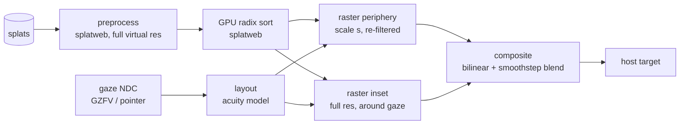

# Foveated Gaussian-splat rendering

Code: `render/src/foveation/` (TypeScript + WGSL, WebGPU). The splat core — EWA projection,
spherical harmonics, GPU radix sort — is splatweb v0.1.0, vendored unmodified in
`render/src/vendor/splatweb/` (MIT, see its README for the commit).

## Pipeline per frame

1. **Shared preprocess + sort.** Both layers see the same camera. The inset is an affine *crop* of
   the full-resolution image and the periphery an affine *down-scale*, so neither the projection nor
   the depth order changes: preprocess (EWA projection to full-resolution pixels) and the radix sort
   run once. This matters because they are resolution-independent (5.0 ms of the 21.8 ms full-resolution frame at
   1 M splats in the benchmark run); a naive "render the scene twice" foveation would pay them twice.
2. **Layer raster** (`foveated_raster.wgsl`): `p_layer = p_full · scale − offset`. Down-scaling a
   Gaussian by s shrinks its covariance by s², so sub-pixel splats would alias. The anti-aliasing
   low-pass of EWA splatting (Zwicker et al. 2001) is re-applied in *layer* pixels,
   `Σ' = s² Σ + 0.3 (1 − s²) I`, with opacity scaled by `√(det(s²Σ)/det Σ')` to keep each splat's
   integrated contribution (the 2D-filter compensation of Mip-Splatting, Yu et al. 2024). Quads
   entirely outside the layer are culled in the vertex shader.
3. **Composite** (`composite.wgsl`): `w = 1 − smoothstep(r_in, r_out, |p − gaze|)`,
   `out = mix(bilinear(periphery), inset, w)` on premultiplied colour.

With `layout = null` the same renderer draws one full-resolution layer straight into the target; a
GPU test checks it matches splatweb's own renderer to ≤ 1 DN per channel.

## Sizing the fovea: acuity model

Minimum angle of resolution grows linearly with eccentricity (Weymouth 1958; used for foveated
rendering by Guenter et al. 2012):

    MAR(e) = m e + MAR0,   MAR0 = 1/48 deg,   m ∈ [0.022, 0.034]  (we use 0.022, conservative)

A layer of pixel pitch `p = 1/(s · ppd)` degrees is acuity-matched beyond `e_min = (p − MAR0)/m`.
For the benchmark display (2160 × 2160 px per eye, 90° vertical FOV → 18.8 px/deg at the centre):

| periphery scale | pitch (deg) | e_min (deg) | + tracking p95 1° + latency 2° = inner radius |
|---|---:|---:|---:|
| 1/2 | 0.106 | 3.9 | 6.9° |
| 1/3 | 0.160 | 6.3 | 9.3° |
| 1/4 | 0.213 | 8.7 | 11.7° |

The tracking-error term is the measured p95 of the calibrated 3D model on the "low"–"medium" noise
synthetic conditions (0.38–0.60°, rounded up to 1°); the latency margin follows Albert et al. (2017).
These are the "acuity" rows of the benchmark. Pixel density on a flat image plane grows away from the
centre (`d(px)/dθ = f / cos² θ`), so `computeLayout` converts degrees to pixels along the radial
direction at the gaze point (`radiusPx`), which makes the inset bigger for eccentric gaze.

## Cost model and what limits the saving

    T_fov = T_pre + T_sort + T_raster(periphery) + T_raster(inset) + T_composite

Rasterisation cost is not proportional to pixel count:

* every layer runs the vertex shader for **every** visible splat (4 vertices × ~1 M instances), even
  when the quad is culled — a fixed per-layer cost;
* the inset sits where the user looks, which in this scene is where the content — and the overdraw —
  is, so the inset's cost per pixel is far above the frame average.

So the saving is real but much smaller than the shaded-pixel fraction suggests; see the README
results. Roadmap items that attack exactly these terms: per-layer instance compaction (tile binning
so the inset only touches splats that overlap it), and LOD/culling of small, faint splats in the
periphery by eccentricity.

## References

* B. Guenter, M. Finch, S. Drucker, D. Tan, J. Snyder. *Foveated 3D graphics.* ACM TOG 31(6), SIGGRAPH Asia 2012.
* R. Weymouth. *Visual sensory units and the minimal angle of resolution.* Am. J. Ophthalmology 46, 1958.
* A. Patney et al. *Towards foveated rendering for gaze-tracked virtual reality.* ACM TOG 35(6), 2016.
* R. Albert, A. Patney, D. Luebke, J. Kim. *Latency requirements for foveated rendering in virtual reality.* ACM TAP 14(4), 2017.
* M. Zwicker, H. Pfister, J. van Baar, M. Gross. *EWA splatting.* IEEE TVCG 8(3), 2002 (and EWA volume splatting, IEEE Vis 2001).
* B. Kerbl, G. Kopanas, T. Leimkühler, G. Drettakis. *3D Gaussian splatting for real-time radiance field rendering.* ACM TOG 42(4), 2023.
* Z. Yu, A. Chen, B. Huang, T. Sattler, A. Geiger. *Mip-Splatting: alias-free 3D Gaussian splatting.* CVPR 2024.
* Z. Wang, A. Bovik, H. Sheikh, E. Simoncelli. *Image quality assessment: from error visibility to structural similarity.* IEEE TIP 13(4), 2004.
